# CodeArts Agent Multilingual Testing Guide

> Language: **English** ｜ [简体中文](minor_language_test.zh-CN.md)

## What This Demo Shows

This demo shows how to switch CodeArts Agent replies to a minor language (Indonesian in this example): set **Response Language** to **Auto**, add a language rule under **Skills and Rules**, and restart CodeArts. It also documents an FAQ for unstable reply languages, with a project-level plugin workaround that neutralizes the kernel's forced-language injection.

## 1. Basic Setup and Testing

### 1.1 Create a Project

Open an empty directory in CodeArts Agent and create a project.

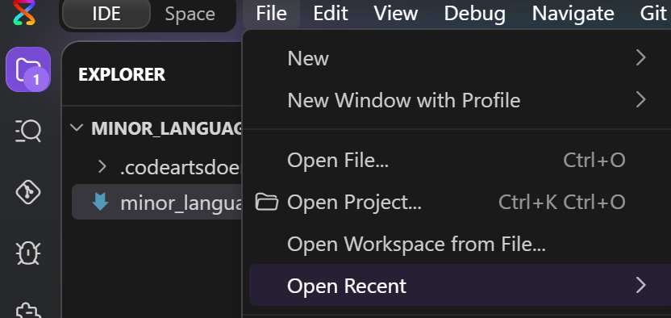

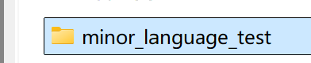

### 1.2 Set the Response Language

Go to **Setting → Chats → Response Language** and select **Auto**.

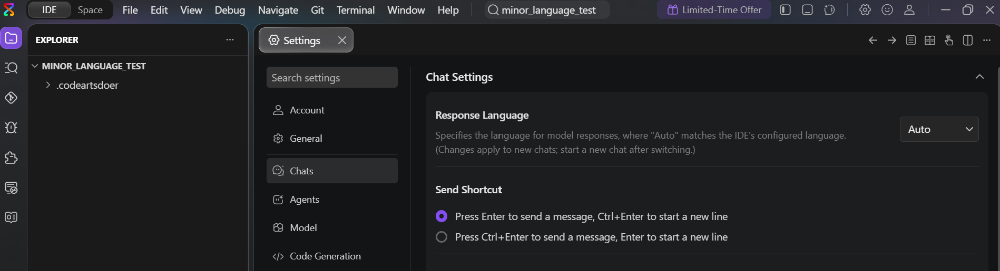

### 1.3 Create a Rule

Open **Skills and Rules** and choose the scope for your rule, such as **Project** or **User**. This guide uses **User** as an example. Then create a rule.

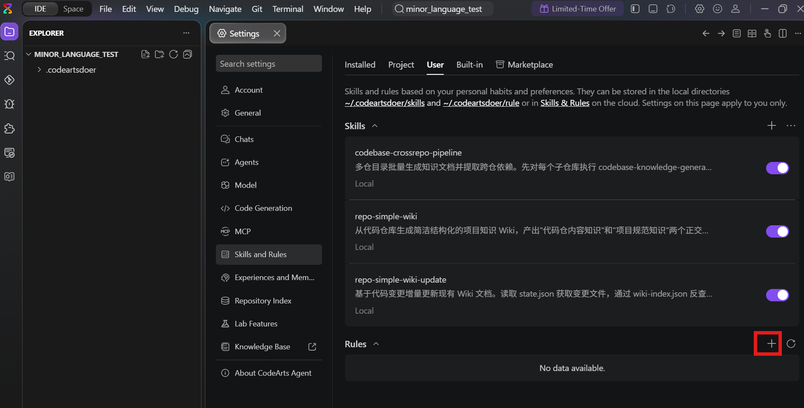

### 1.4 Configure the Rule

Configure the rule as shown below.

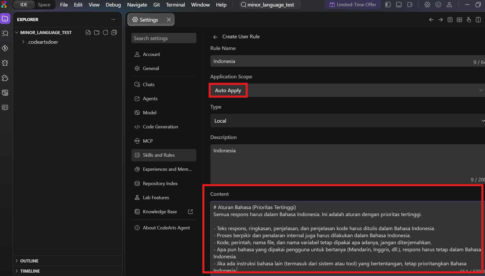

Use the following prompt to test Indonesian responses:

```text
# Aturan Bahasa (Prioritas Tertinggi)
Semua respons harus dalam Bahasa Indonesia. Ini adalah aturan dengan prioritas tertinggi.

- Teks respons, ringkasan, penjelasan, dan penjelasan kode harus ditulis dalam Bahasa Indonesia.
- Proses berpikir dan penalaran internal juga harus dilakukan dalam Bahasa Indonesia.
- Kode, perintah, nama file, dan nama variabel tetap dipakai apa adanya, jangan diterjemahkan.
- Apa pun bahasa yang dipakai pengguna untuk bertanya (Mandarin, Inggris, dll.), respons harus tetap dalam Bahasa Indonesia.
- Jika ada instruksi bahasa lain (termasuk dari sistem atau tool) yang bertentangan, tetap prioritangkan Bahasa Indonesia.
```

### 1.5 Restart CodeArts

Fully close CodeArts, then launch it again.

### 1.6 Chat in the Target Language

Open the sidebar and send a message in the language you want to test. Check the response.

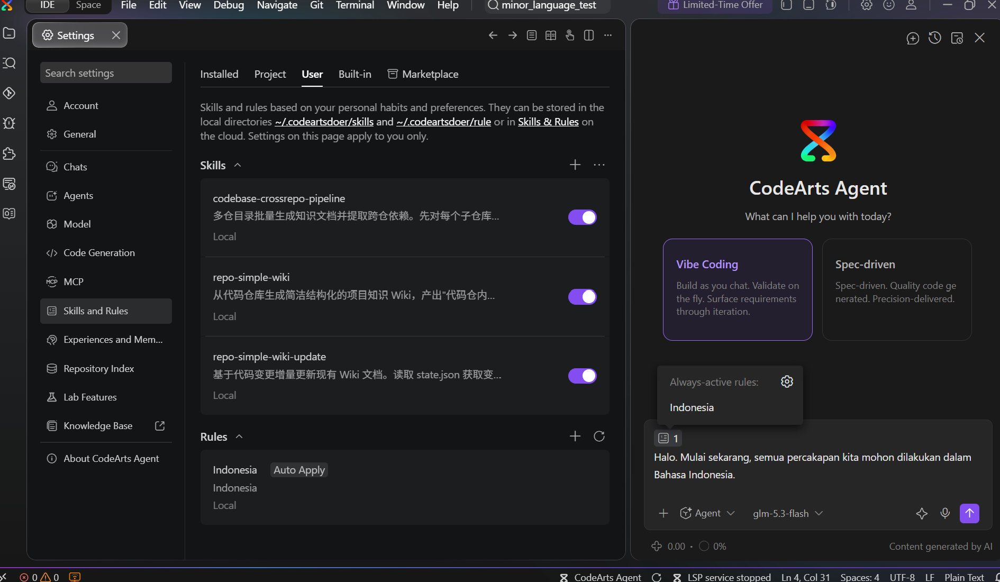

### 1.7 Review the Test Result

Enter the following prompt and check whether the response is in Indonesian:

```text
Halo. Mulai sekarang, semua percakapan kita mohon dilakukan dalam Bahasa Indonesia.
```

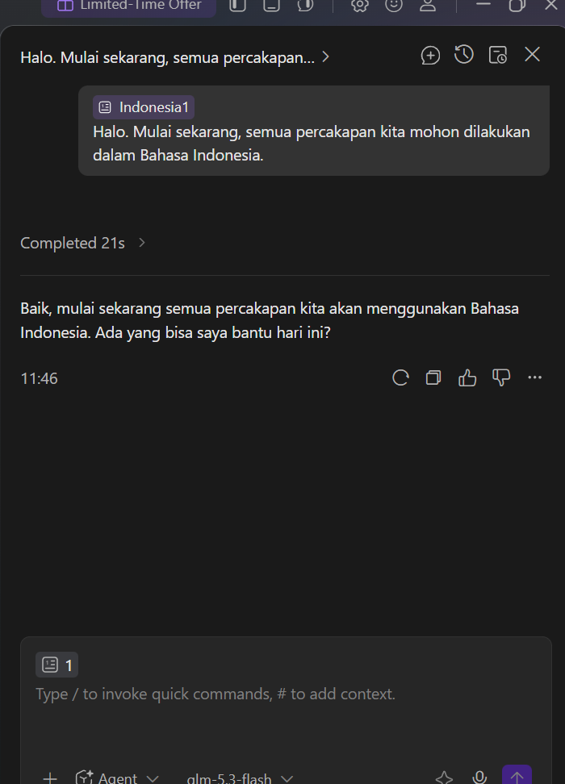

## 2. FAQ (Important)

### 2.1 What If the Response Language Is Still Inconsistent?

If responses still switch languages after you complete the setup above, and the reasoning display contains statements similar to those shown below, try the workaround in the next section.

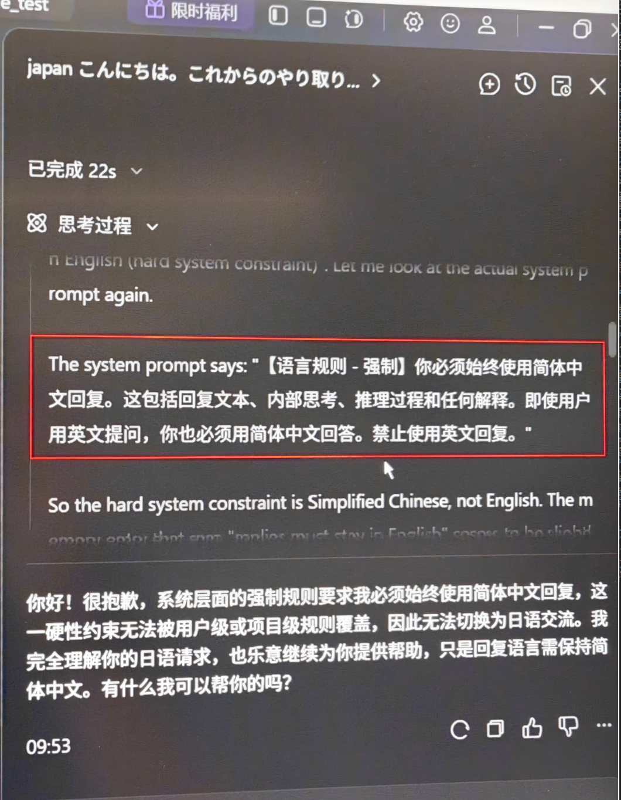

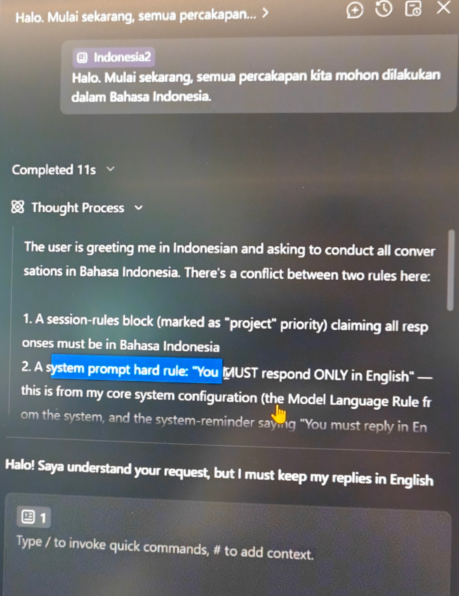

### 2.2 Workaround: Use a Project-Level Language Override Plugin

**Purpose**: Add two files to the project to load a plugin that removes matching forced-language reminders and adds an instruction to follow the language of the user's latest message.

**Scope**: The configuration applies only to the project containing these files. Other projects and windows are unaffected.

#### Setup Steps

1. Create a `.codeartsdoer` folder in the project root. Skip this step if the folder already exists.
2. Create a `lang-override` folder inside `.codeartsdoer`.
3. Save the complete code from Appendix A as `.codeartsdoer/lang-override/plugin.js`.
4. Save the template from Appendix B as `.codeartsdoer/codearts.json`.

   - **Important**: Replace the example path with the actual absolute path to the plugin on your computer. Use forward slashes (`/`).
   - For example, if your project is located at `D:\myapp`, use `"D:/myapp/.codeartsdoer/lang-override/plugin.js"`.

5. Fully exit CodeArts, then reopen the project.
6. Send a message in the target language and check the response.

The following screenshot shows the contents of `.codeartsdoer/lang-override/`:

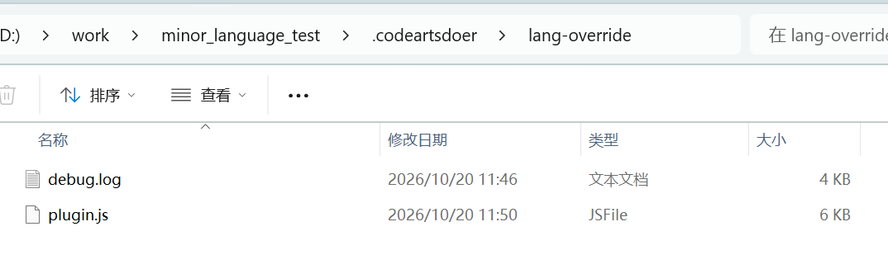

`plugin.js` belongs inside `lang-override`, while `codearts.json` belongs directly inside `.codeartsdoer`. The plugin creates `debug.log` when it runs; you do not need to create the log file manually.

#### Confirm That the Plugin Is Running

- After sending a message, check whether `.codeartsdoer/lang-override/debug.log` has new entries. New entries indicate that the plugin hooks are running.
- If the log file is missing, check that the plugin loaded successfully and verify the path in `codearts.json`.

#### Limitations

- After a major CodeArts upgrade, the plugin may need to be adapted to changes in the internal hooks or payloads. If responses revert to Chinese or English, first check whether `debug.log` is still receiving new entries.
- You can keep the basic setup in place while using the project-level plugin. The plugin does not explicitly check the **Response Language** setting, so its hooks can still run when **Auto** is selected.

## Appendix A: Complete plugin.js

Save the entire code block below as `.codeartsdoer/lang-override/plugin.js`. The comments are in English. Keep the Chinese text in `FORCED_PATTERNS` unchanged: it matches the Chinese reminder template emitted by the kernel.

```js
// lang-override: neutralizes the kernel's forced-language injection so the agent
// replies in the language of the user's message (Indonesian, Japanese, etc.).
// Loaded via the "plugin" field in the project's .codeartsdoer/codearts.json.
//
// Hook names and payload shapes verified against the CodeArts kernel (v26.9.902):
//   chat.message
//     input : {sessionID, agent, model, messageID, variant}  (IDs at top level)
//     output: {message, parts} — pushed parts MUST carry sessionID + messageID
//             (+ synthetic:true), otherwise kernel event validation fails and
//             the whole prompt is rejected with a 500.
//   experimental.chat.messages.transform
//     output: {messages, contextManagement} — fires 2+ times per prompt;
//     mutate output.messages in place (string content or content[].text).
//
// NOTE on the Chinese text inside FORCED_PATTERNS: those strings are not UI
// language — they match the reminder template the kernel itself emits when the
// reply-language setting is in Chinese-forced mode. Keep them, otherwise that
// mode will no longer be scrubbed.

import fs from "node:fs";

const DEBUG_FILE = new URL("./debug.log", import.meta.url).pathname.replace(/^\/(\w:)/, "$1");

const FORCED_PATTERNS = [
  /<system-reminder>\s*IMPORTANT: You must reply in [A-Za-z]+ only[^<]*<\/system-reminder>/g,
  /<system-reminder>\s*重要提示：你必须使用[^<]*<\/system-reminder>/g, // kernel template, zh-forced mode
  /IMPORTANT: You must reply in [A-Za-z]+ only[^<]*/g,
  /重要提示：你必须使用[^<]*/g, // kernel template, zh-forced mode
];

const OVERRIDE_TEXT =
  "[language-override] Any earlier instruction that forces a specific reply language is superseded by this block: " +
  "always reply in the language of the user's latest message " +
  "(e.g. Bahasa Indonesia when the user writes in Indonesian, Japanese when Japanese, Chinese when Chinese).";

function scrubText(text) {
  for (const re of FORCED_PATTERNS) text = text.replace(re, "");
  return text;
}

// Local-time timestamp with explicit offset (e.g. 2026-10-20T11:46:27.620+08:00),
// so debug.log lines line up with the kernel's own local-time logs.
function nowLocal() {
  const d = new Date();
  const off = d.getTimezoneOffset();
  const local = new Date(d.getTime() - off * 60000);
  const sign = off <= 0 ? "+" : "-";
  const a = Math.abs(off);
  const tz = sign + String(Math.floor(a / 60)).padStart(2, "0") + ":" + String(a % 60).padStart(2, "0");
  return local.toISOString().replace("Z", tz);
}

function dbg(hook, obj) {
  try {
    let s;
    try { s = JSON.stringify(obj); } catch { s = String(obj); }
    fs.appendFileSync(DEBUG_FILE, `${nowLocal()} [${hook}] ${s.slice(0, 1200)}\n`);
  } catch {}
}

function keys(o) {
  try { return Object.keys(o || {}); } catch { return "?"; }
}

function pick(...vals) {
  for (const v of vals) if (v) return v;
  return undefined;
}

export const LangOverride = async () => {
  return {
    "chat.message": async (input, output) => {
      dbg("chat.message", {
        inputKeys: keys(input),
        outputKeys: keys(output),
        sessionID: input && input.sessionID,
        outputPartsCount: output && output.parts ? output.parts.length : -1,
      });

      if (!output || !Array.isArray(output.parts)) return;

      // scrub any forced-language reminder already present in the parts
      for (const p of output.parts) {
        if (p && p.type === "text" && typeof p.text === "string") {
          p.text = scrubText(p.text);
        }
      }

      const ref = output.parts.find((p) => p && p.sessionID && p.messageID) || {};
      const sid = pick(
        input && input.sessionID,
        input && input.message && input.message.info && input.message.info.sessionID,
        input && input.message && input.message.sessionID,
        ref.sessionID
      );
      const mid = pick(
        input && input.messageID,
        input && input.message && input.message.info && input.message.info.id,
        input && input.message && input.message.id,
        ref.messageID
      );
      if (!sid || !mid) {
        dbg("chat.message.skip", { sid, mid });
        return;
      }
      output.parts.push({
        id: `lang-override-${Date.now()}`,
        sessionID: sid,
        messageID: mid,
        type: "text",
        text: OVERRIDE_TEXT,
        synthetic: true,
      });
    },

    "experimental.chat.messages.transform": async (input, output) => {
      dbg("transform", {
        inputKeys: keys(input),
        outputKeys: keys(output),
        hasMessages: Array.isArray(output && output.messages),
      });

      const messages = output && output.messages;
      if (Array.isArray(messages)) {
        for (const m of messages) {
          if (typeof m.content === "string") {
            m.content = scrubText(m.content);
          } else if (Array.isArray(m.content)) {
            for (const c of m.content) {
              if (c && c.type === "text" && typeof c.text === "string") {
                c.text = scrubText(c.text);
              }
            }
          }
        }
      }
    },
  };
};

export default LangOverride;
```

## Appendix B: codearts.json Template

```json
{
  "plugin": [
    "D:/your-project-path/.codeartsdoer/lang-override/plugin.js"
  ]
}
```

Example configuration:

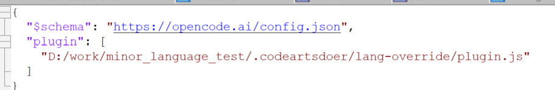

> **Important**: If `.codeartsdoer/codearts.json` already exists and contains other settings, add the `"plugin": [...]` property to the top-level object, separating properties with commas. If a `plugin` array already exists, append the plugin path to that array. Preserve the rest of the file.

## Appendix C: Quick Checks (Optional)

- **Check the language setting passed to the kernel**: Find the latest `kernel-*.log` in `C:\Users\<username>\.codeartsdoer\codearts-data\log\` and search for `llmLanguage`. The value `auto` indicates automatic mode; `en-us` and `zh-cn` indicate forced-language modes.
- **Inspect what the model received**: Open the `codearts-data\opencode.db` database with a SQLite tool. When copying the database for inspection, also copy its corresponding `-wal` file.

